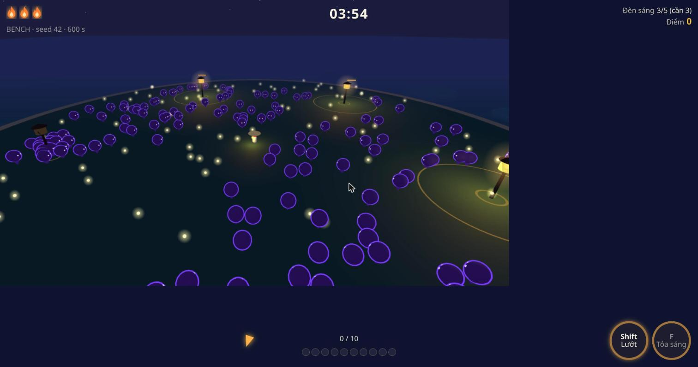
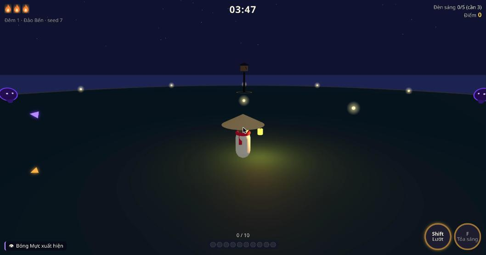
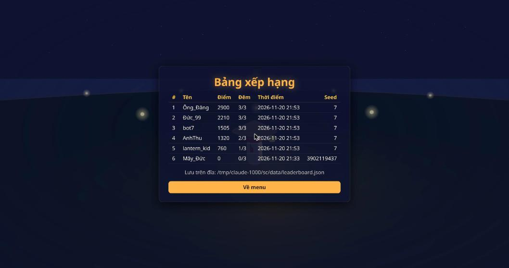

# Đảo Đèn Lồng

> **Video demo:** _(đang chờ quay — kịch bản: [`docs/demo/README.md`](docs/demo/README.md))_ · **Bản phát hành:** GitHub Release `v1.0.0`
> (`dao-den-long-v1.0.0-web.zip`)

Game 3D góc nhìn thứ ba: Mây, người giữ đèn nhỏ tuổi, gom đom đóm để thắp Đèn Lồng Lớn, giữ đảo sáng tới bình minh và
xua Bóng Mực trong sương đen qua ba Đêm trên ba hòn đảo. TypeScript + Three.js (bản web) và chế độ headless chạy bằng
Node theo **Test Contract v1.3**.



| | |
|---|---|
|  |  |

## Yêu cầu hệ thống

- **Node.js ≥ 18** (đã thử với Node 24) và npm; Linux, macOS hoặc Windows.
- Trình duyệt có **WebGL2**: Chrome/Chromium/Edge (khuyên dùng), Firefox, Safari.
- Benchmark cần **Chrome, Chromium, Edge hoặc Brave** cài trên máy (tự dò; hoặc đặt `CHROME_PATH`).
- Card đồ họa tích hợp là đủ: máy tham khảo (AMD Radeon 780M) đạt ~176 FPS trong cảnh benchmark.

## Cài đặt và chạy (3 lệnh)

```bash
npm ci
npm run build
npm start          # mở http://127.0.0.1:4173 trong trình duyệt (Ctrl+C để tắt)
```

Bản phát hành (không cần mã nguồn): tải `dao-den-long-v1.0.0-web.zip` ở Release `v1.0.0`, giải nén, chạy
`node run.js`. Khi phát triển: `npm run dev`.

## Luật chơi tóm tắt

- Đi gần đom đóm để **tự nhặt** (trong 1 m, cùng tầng). Sức chứa 10, +2 mỗi lần thắp đèn thành công (tối đa 20).
- Đứng trong 2 m của đèn và bấm **Tương tác**: đèn chưa sáng nhận đom đóm tới 10 con (5 con nếu đèn đã từng sáng) thì
  sáng với **100 dầu**; đèn đang sáng thì **châm dầu** (+10 dầu mỗi con, tối đa 100).
- Đèn sáng **hao 1 dầu/giây**; hết dầu thì tắt. Dầu dưới 30: đèn nhấp nháy, **mất vùng an toàn** và Bóng Mực tới **hút
  dầu** (5/giây mỗi con).
- **Bóng Mực** xuất hiện từ giây thứ 5, lang thang rồi đuổi khi bạn ở trong 12 m (4 m/s; Đêm 3 là 4.5 m/s). Bị chạm: mất
  1 Ngọn Lửa, rơi một nửa số đom đóm đang mang, bất tử 1.5 s. Chúng không vào vùng 6 m quanh đèn sáng còn ≥ 30 dầu.
- **Tỏa Sáng** (tốn 3 đom đóm, hồi 3 s): choáng 2 s và đẩy lùi 4 m mọi Bóng Mực trong 5 m.
- **Lướt**: 14 m/s trong 0.2 s, hồi 1.5 s. Rơi khỏi đảo: mất 1 lửa và toàn bộ đom đóm, hồi sinh ở điểm xuất phát.
- **Gió Lạc** (Đêm 2–3) cướp 3 đom đóm khi bạn mang ≥ 5. **Bùa Gió**: 10 s chạy 7.2 m/s, Lướt không hồi chiêu.
  **Gió mạnh** (Đêm 3): mỗi 30 s một cơn 5 s đẩy bạn 2 m/s, báo trước 2 s.
- **Thắng** khi còn sống lúc **bình minh** và số đèn đang sáng ≥ 60% (3/5, 4/6, 5/7). Hết 3 lửa, hoặc bình minh mà
  thiếu đèn → **thua**, được chơi lại Đêm đó.

| Đêm | Đảo | Đèn | Thời gian | Điểm đặc biệt |
|---|---|---|---|---|
| 1 | Đảo Bến | 5 | 4:00 | Đảo tròn 40 m |
| 2 | Đảo Cau | 6 | 4:30 | Hai đảo, cầu tre, bục nhảy, Gió Lạc, Bùa Gió |
| 3 | Đảo Chuông | 7 | 5:00 | 3 tầng, 2 dốc, bục nhảy lên tầng 2, tháp chuông, gió mạnh |

**Điểm:** +5 mỗi đom đóm nạp vào đèn; +100 thắp lần đầu / +40 thắp lại; +5 mỗi Bóng Mực trúng Tỏa Sáng (+15 nếu nó đang
hút dầu); thắng Đêm: mỗi đèn sáng +50 + số dầu còn lại, +50 mỗi Ngọn Lửa. Điểm lượt chơi = tổng điểm các Đêm đã thắng.

## Điều khiển

| Phím mặc định | Hành động |
|---|---|
| W A S D | Di chuyển (theo hướng camera) |
| Chuột (click để khóa) / ← → | Xoay camera |
| Space | Nhảy |
| Shift trái | Lướt |
| E | Tương tác: nạp đom đóm / thắp lại / châm dầu |
| F | Tỏa Sáng |
| P hoặc Esc | Tạm dừng: Tiếp tục / Chơi lại Đêm / Cài đặt / Về menu |
| Enter | Nút chính trên các màn hình |

**Cài đặt** (lưu lại cho lần sau): âm lượng, độ nhạy chuột, **đổi phím** cho 9 hành động (phím trùng bị từ chối và báo
tên hành động đang dùng; nút "Khôi phục mặc định"), **phụ đề và mũi tên chỉ báo** (Bóng Mực xuất hiện, gió sắp thổi,
10 giây cuối, đèn dưới 30 dầu), **giảm chuyển động** (không rung camera, không chớp màn hình), **chữ lớn ×1.25** (chữ
UI tối thiểu 18 px), **bảng màu dễ phân biệt**. Âm thanh tổng hợp bằng WebAudio, không dùng file ngoài.

**Bảng xếp hạng** (menu chính): sau khi thua một Đêm hoặc tới Bình Minh, nhập tên (3–12 ký tự, chữ có dấu tiếng Việt
được) để lưu top 10. File lưu trên đĩa: `~/.local/share/dao-den-long/leaderboard.json` (Linux),
`~/Library/Application Support/dao-den-long/` (macOS), `%APPDATA%\dao-den-long\` (Windows); `DDL_DATA_DIR` đổi được.

```bash
node dist-headless/app/run.js --export-leaderboard out.json     # {"entries": [...]} đúng thứ tự (= run_cmd trong contract)
```

## Kiểm thử

```bash
npm test           # build headless + vitest: 175 test (luật, chạy CLI end-to-end, tất định, bench, soak, bảng xếp hạng)
npm run typecheck
```

CI chạy cùng bộ test mỗi lần push (`.github/workflows/ci.yml`).

## Chế độ headless (Test Contract v1.3)

```bash
node dist-headless/headless/cli.js --seed 1 --night 1 --ticks 600 --out out.jsonl \
  [--inputs f.inputs.json] [--scenario f.scenario.json] [--snapshot-every 10]
```

- `--night` 1, 2, 3. Mã thoát: `0` thành công, `1` sai tham số/lỗi đọc file, `2` file inputs/scenario sai định dạng.
- Khai báo: [`game.contract.json`](game.contract.json) (`contract_version: "1.3"`, `build_cmd`, `run_cmd`,
  `headless_cmd`, `bench_cmd`, `soak_cmd`, `tuning`). Đầu ra headless giống hệt v1.2.
- 21 600 tick ≈ 1–2 s (yêu cầu ≤ 30 s).

## Benchmark (Ticket-04 §1)

```bash
node dist-headless/app/bench.js --seed 42 --duration 30 --out bench.json     # = bench_cmd; hoặc: npm run bench
```

Mở Chrome/Chromium có sẵn trên máy thành **cửa sổ 1280×720** (`--app`), **tắt vsync** (`--disable-gpu-vsync
--disable-frame-rate-limit`), chạy cảnh chuẩn (Đêm 1 đủ ánh sáng, 200 Bóng Mực `wander`, 100 đom đóm, L1–L3 sáng
dầu 100, camera bay vòng r 30 m ở Y 15 m, 15 s/vòng), bỏ 3 s khởi động, đo đúng `--duration` giây, ghi `bench.json`
và tự thoát mã 0. `peak_mem_mb` = tổng RSS của cả cây tiến trình (Node + Chrome), đo bằng `ps`; trên Windows ghi
`null` vì không có `ps`. Chi tiết và lý do: ADR-004 trong [`phase-4-assumptions.md`](docs/notes/phase-4-assumptions.md).

Kết quả tự đo: [`bench.json`](bench.json) (máy tham khảo, không phải máy chấm).

## Soak test (Ticket-04 §2)

```bash
node --expose-gc dist-headless/headless/soak.js --seed 7 --nights 10 --out soak.json   # = soak_cmd; hoặc: npm run soak
#   thêm --trace 1 để in RSS và heap JS sau từng Đêm
```

10 Đêm liên tiếp trong một tiến trình (Đêm 1 → 2 → 3 xoay vòng, seed 7, 8, …), input ngẫu nhiên theo seed. Kết quả tự
đo: [`soak.json`](soak.json) — **0 crash; tỷ lệ RSS cuối/đầu 1.37, chưa đạt ngưỡng ≤ 1.2**. Không phải rò rỉ: heap JS
giữ ~5 MB suốt 30 Đêm và RSS gần như đi ngang từ Đêm 3; phần tăng chủ yếu là lần khởi động JIT của V8 trong Đêm đầu (giải thích và
số liệu: [`docs/proof/phase-4/`](docs/proof/README.md#phase-4-ticket-04-bình-minh-phát-hành-v100-contract-v13)).

## Bot tự chơi và phát lại

```bash
npm run autoplay -- --seed 7 --night 3      # bot chơi qua sim thật, ghi public/replays/n3-seed7-win.inputs.json
npm run build && npm start                  # rồi mở:
# http://127.0.0.1:4173/?seed=7&replay=replays/n{night}-seed7-win.inputs.json&speed=4     (cả 3 Đêm → Bình Minh)
```

## Tài liệu

- Thay đổi qua 4 phase: [`CHANGELOG.md`](CHANGELOG.md) · Nguồn asset/công cụ: [`CREDITS.md`](CREDITS.md) · Giấy phép: [MIT](LICENSE)
- Ticket chép lại, giả định từng phase, nhật ký AI, retro: [`docs/notes/`](docs/notes/)
- Bằng chứng từng phase: [`docs/proof/`](docs/proof/README.md); tái tạo số đo Phase 4: `scripts/proof-phase4.sh`
- Harness AI: [`CLAUDE.md`](CLAUDE.md), [`.claude/settings.json`](.claude/settings.json) (hook Stop chặn kết thúc khi
  test đỏ), skill [`play-and-capture`](.claude/skills/play-and-capture/SKILL.md)
- Đề bài lab: [`docs/lab/`](docs/lab/)
- Đóng gói Release: `npm run build && npm run package` → `release/dao-den-long-v1.0.0-web.zip`
